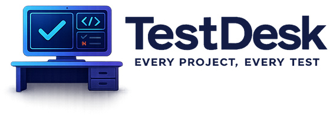
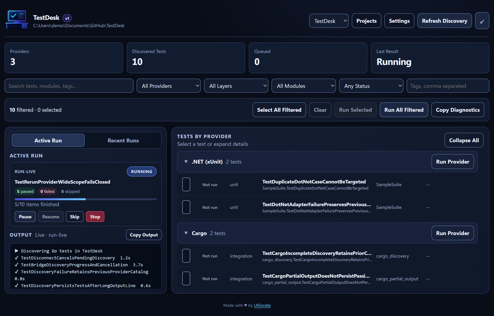
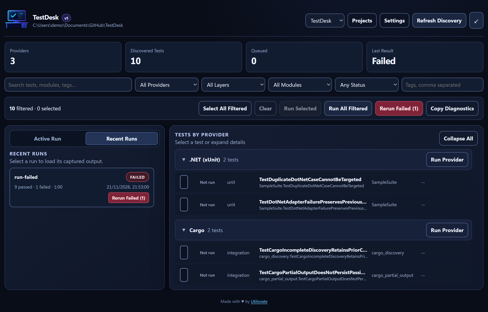
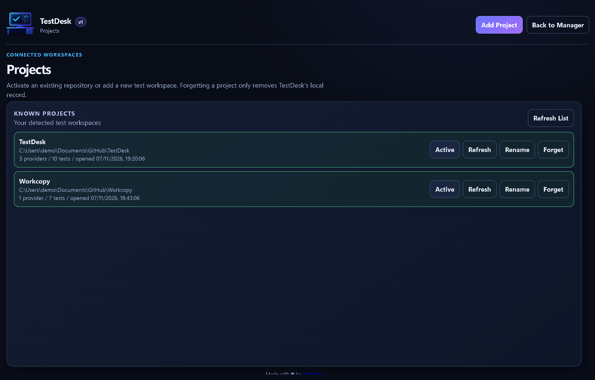
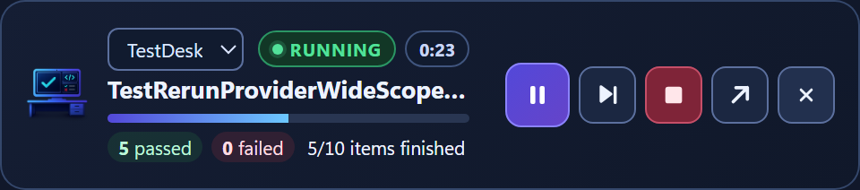
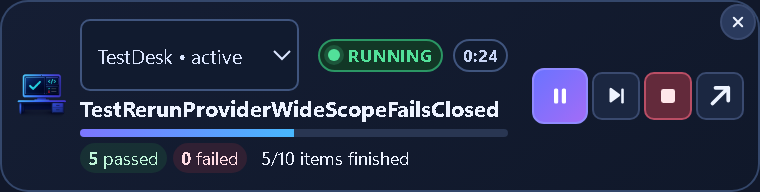
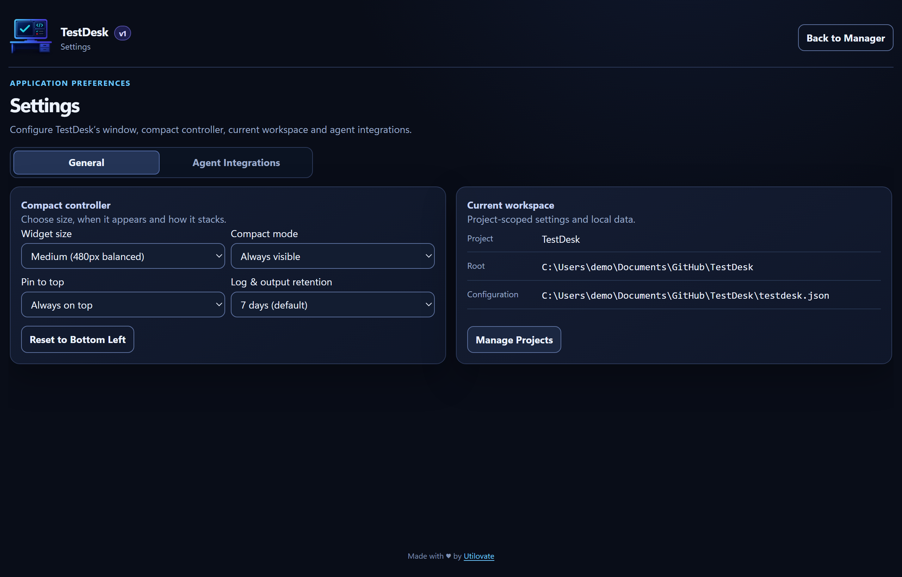
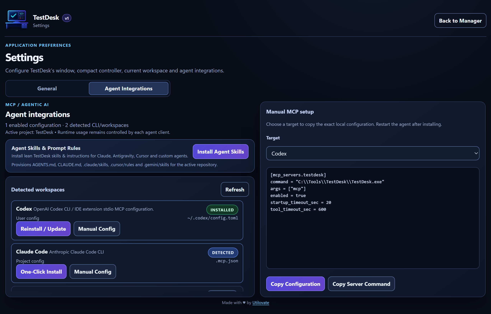

<p align="center">
  <picture>
    <source media="(prefers-color-scheme: dark)" srcset="docs/assets/testdesk-logo-on-dark.png">
    
  </picture>
</p>

<p align="center">
  <strong>Find, run, and debug project tests from one desktop window, or let your AI agent drive them safely over local MCP.</strong>
</p>

<p align="center">
  <a href="https://github.com/thecodingrasta/TestDesk/actions/workflows/ci.yml"></a>
  <a href="https://github.com/thecodingrasta/TestDesk/releases"></a>
  <a href="LICENSE"></a>
</p>

Long test runs are hard to follow when output scrolls off screen or when an AI agent runs checks in the background. TestDesk gives every project its own discovery catalog, run queue, live output viewer, and failure history. You can keep the full manager open while working, or opt to have a compact floating controller appear whenever tests are active.

TestDesk runs the test tools already installed on your machine (Go, .NET, Vitest, Jest, Cargo, Playwright, pytest, Maven, Gradle, and Cypress). It does not install compilers or language runtimes for you. Read the [changelog](CHANGELOG.md), [release checks](docs/RELEASING.md), and [security policy](SECURITY.md) before using it on sensitive repositories.

---

## Download and run

Grab a prebuilt binary from [GitHub Releases](https://github.com/thecodingrasta/TestDesk/releases). No Go toolchain or build steps are needed. (Wait for a published release tag or check GitHub Actions workflow artifacts on `main` if no public release is listed yet.)

| Platform | CPU | Desktop app (single file) | Optional CLI | Full package (with licence texts) |
| --- | --- | --- | --- | --- |
| Windows 10 / 11 | x64 (`amd64`) | `TestDesk-<version>-windows-amd64.exe` | `testdesk-cli-<version>-windows-amd64.exe` | `TestDesk-<version>-windows-amd64.zip` |
| Linux | x64 (`amd64`) | `TestDesk-<version>-linux-amd64` | `testdesk-cli-<version>-linux-amd64` | `TestDesk-<version>-linux-amd64.tar.gz` |
| macOS | Apple silicon (`arm64`) | Inside full package (`.app`) | `testdesk-cli-<version>-macos-arm64` | `TestDesk-<version>-macos-arm64.tar.gz` |
| macOS | Intel (`amd64`) | Inside full package (`.app`) | `testdesk-cli-<version>-macos-amd64` | `TestDesk-<version>-macos-amd64.tar.gz` |

The desktop app also includes the local MCP server (`testdesk mcp`), so the app download alone is enough for agent integrations. Keep `testdesk-cli` in the same folder as the desktop app if you want the CLI to launch it automatically. On macOS, desktop apps are `.app` bundle folders, so the app is distributed inside the `.tar.gz` archive.

Not sure which Mac chip you have? Open the Apple menu, choose **About This Mac**, and check **Chip** or **Processor**.

<details open>
<summary><strong>Windows</strong></summary>

Double-click `TestDesk-<version>-windows-amd64.exe` to launch directly without changing `PATH`.

If you also want `testdesk` and `testdesk-cli` on your user `PATH`, run this in PowerShell from your Downloads folder, then open a new terminal:

```powershell
New-Item -ItemType Directory -Force "$HOME\bin" | Out-Null
Move-Item .\TestDesk-*-windows-amd64.exe "$HOME\bin\testdesk.exe"
Move-Item .\testdesk-cli-*-windows-amd64.exe "$HOME\bin\testdesk-cli.exe"
[Environment]::SetEnvironmentVariable('Path', "$([Environment]::GetEnvironmentVariable('Path', 'User'));$HOME\bin", 'User')
```

- **SmartScreen prompt:** Builds are not code-signed yet. After verifying the checksum below, choose **More info**, then **Run anyway**.
- **WebView2 runtime:** Windows 11 includes Microsoft Edge WebView2. On Windows 10, install the [Evergreen WebView2 Runtime](https://developer.microsoft.com/en-us/microsoft-edge/webview2/) if the window fails to open.

</details>

<details>
<summary><strong>Linux</strong></summary>

Install the GTK 3, WebKitGTK 4.1, and AppIndicator runtime libraries, make the binary executable, and run it (Ubuntu 24.04 package names shown):

```bash
sudo apt-get install libgtk-3-0t64 libwebkit2gtk-4.1-0 libayatana-appindicator3-1
install -D -m 755 TestDesk-*-linux-amd64 ~/.local/bin/testdesk
install -D -m 755 testdesk-cli-*-linux-amd64 ~/.local/bin/testdesk-cli   # optional
testdesk
```

Other Linux distributions package WebKitGTK 4.1 and `libayatana-appindicator3` under their own package names. If your desktop environment is GNOME, tray icons may require an AppIndicator shell extension. `~/.local/bin` is optional; you can also mark the downloaded file `chmod +x` and run `./TestDesk-*-linux-amd64` directly.

</details>

<details>
<summary><strong>macOS</strong></summary>

1. Open the `.tar.gz` matching your chip (`arm64` for Apple silicon, `amd64` for Intel) and drag `TestDesk.app` to **Applications**.
2. Open the app. Because builds are not signed or notarised yet, macOS Gatekeeper blocks the first launch. Open **System Settings**, go to **Privacy & Security**, and choose **Open Anyway**.

For the optional CLI (`testdesk-cli`), mark it executable and place it in a `PATH` directory such as `/usr/local/bin/testdesk-cli`:

```bash
chmod +x testdesk-cli-*-macos-*
xattr -d com.apple.quarantine testdesk-cli-*-macos-*   # after verifying SHA256SUMS
```

When using `testdesk-cli mcp` separately from the `.app`, set `TESTDESK_DESKTOP_EXECUTABLE` to `/Applications/TestDesk.app/Contents/MacOS/testdesk` (or invoke that binary directly with `mcp`).

</details>

<details>
<summary><strong>Verify checksums</strong></summary>

Every release ships a `SHA256SUMS` file covering all archives and standalone binaries. Download `SHA256SUMS` beside your file and verify before running:

```powershell
# Windows (PowerShell): compare output with the matching line in SHA256SUMS
Get-FileHash .\TestDesk-*-windows-amd64.exe -Algorithm SHA256
```

```bash
# Linux
sha256sum -c SHA256SUMS --ignore-missing

# macOS
shasum -a 256 -c SHA256SUMS --ignore-missing
```

</details>

---

## Your first run

1. Open **TestDesk**. On first launch, choose a folder on the **Projects** screen (or click **Add Project** later from the top bar).
2. Click **Preview Detection** to confirm the detected test providers, keep **Discover tests immediately** checked, and click **Add Project**.
3. Filter tests in the manager by search query, provider, layer, module, status, or tags. Check individual tests or click **Run Provider** / **Run Selected**.
4. Watch live progress and captured stdout/stderr in the **Output** pane. Click **Recent Runs** to inspect earlier logs, **Rerun Failed** to re-test only failures, or **Copy Diagnostics** for a bounded report.
5. Open **Settings**, **General** tab to tune the compact controller:
   - **Compact mode:** defaults to **Auto (show on run / minimise)** (`when_active`), or choose **Always visible** or **Off / manual only (tray only)**.
   - **Widget size:** **Small (380px HUD)**, **Medium (480px balanced)** (default), or **Large (580px spacious)**.
   - **Pin to top:** keep the controller above other windows **Always on top**, **While running tests only**, or **Off**.

More detail on every screen and keyboard shortcut is in the [quickstart](docs/QUICKSTART.md) and [configuration guide](docs/CONFIGURATION.md).

---

## Screenshots

Select any screenshot to view it at full size. All images are rendered from sample data; [how they are captured](docs/SCREENSHOTS.md) explains the harness.

<p align="center">
  <a href="docs/assets/screenshots/manager-overview.png"></a>
  <br><sub><strong>Main manager.</strong> Filter by provider, layer, module, or status, resize the inspector, and monitor live run output beside test cases.</sub>
</p>

<table>
  <tr>
    <td width="50%" valign="top">
      <a href="docs/assets/screenshots/manager-recent-failure.png"></a>
      <br><sub><strong>Failure recovery.</strong> Switch to <strong>Recent Runs</strong> to inspect saved logs with clear run attribution and queue <strong>Rerun Failed</strong> directly.</sub>
    </td>
    <td width="50%" valign="top">
      <a href="docs/assets/screenshots/projects.png"></a>
      <br><sub><strong>Multiple projects.</strong> Add repositories, preview detected test providers, or switch between independent workspaces without losing queues.</sub>
    </td>
  </tr>
  <tr>
    <td width="50%" valign="top">
      <a href="docs/assets/screenshots/compact-running.png"></a>
      <br><sub><strong>Compact controller (medium, 480px).</strong> Keep progress, clock, and playback controls floating in view while editing code.</sub>
    </td>
    <td width="50%" valign="top">
      <a href="docs/assets/screenshots/compact-small-running.png"></a>
      <br><sub><strong>Small 380px HUD &amp; multi-project switcher.</strong> Switch active project queues directly inside the floating bar or view <a href="docs/assets/screenshots/compact-multi-project.png">two active projects</a>.</sub>
    </td>
  </tr>
  <tr>
    <td width="50%" valign="top">
      <a href="docs/assets/screenshots/settings-general.png"></a>
      <br><sub><strong>General settings.</strong> Choose compact widget size, auto-show behavior, pinning, and log retention, or reset widget position.</sub>
    </td>
    <td width="50%" valign="top">
      <a href="docs/assets/screenshots/settings-agent-integrations.png"></a>
      <br><sub><strong>Agent Integrations.</strong> Install skills and instructions into your repo, inspect detected MCP workspaces, or copy exact JSON/TOML snippets.</sub>
    </td>
  </tr>
</table>

---

## Connect an AI agent (MCP and Agent Skills)

The TestDesk binary runs a local stdio MCP server (`testdesk mcp`) with no network listener. Every project keeps an isolated queue and catalog, so agents can test across several repositories concurrently without interfering with one another.

### Easiest setup

1. Open **Settings**, switch to the **Agent Integrations** tab, and click **Install Agent Skills** to write the lean project skills (`SKILL.md` plus on-demand `references/`) and delimited instruction blocks (`AGENTS.md`, `CLAUDE.md`, `GEMINI.md`, `.cursor/rules/testdesk.mdc`, `.github/copilot-instructions.md`).
2. Under **Detected workspaces**, click **Install** beside your host (TestDesk creates a timestamped `.testdesk-backup-*` file before modifying existing configs), or pick a target under **Manual MCP setup** and click **Copy Configuration**.
3. Restart your agent host and ask:

> "Use TestDesk MCP to find the tests in this repository, run the ones my change affects, and show bounded diagnostics for any failure."

### Host installation matrix

| Host / Standard | Recommended route | Config or artifact | Prerequisite & scope |
| --- | --- | --- | --- |
| Portable Agent Plugins | `testdesk_agent_plugin_v<VER>.zip` (Devin, Hermes, Kiro Power) | Root `plugin.json`, `mcp.json`, `skills/` | `testdesk` on `PATH` |
| Claude Code | `.claude-plugin/marketplace.json` or **Install** / `testdesk_agent_claude-code` | `.mcp.json` (`mcpServers`) + `.claude/skills/` | Repo or user config |
| OpenAI Codex | **Install** (`codex mcp-install`), `examples/codex-mcp-config.toml`, `.agents/skills/` | `~/.codex/config.toml` (`[mcp_servers.testdesk]`) | User config; `testdesk_agent_openai-skills-only` fallback |
| Google Antigravity | **Install** or `testdesk_agent_antigravity` | `~/.gemini/config/mcp_config.json`, `assets/logo.png` | User config |
| Cursor | `.cursor-plugin/marketplace.json` or **Install** (`cursor`) / `testdesk_agent_cursor` | `.cursor/mcp.json` + `.cursor/rules/testdesk.mdc` | Repo config |
| VS Code / GitHub Copilot | `.github/plugin/marketplace.json` or **Install** (`vscode` / `cline`) | `.vscode/mcp.json` (`servers.testdesk`) + `.github/` | Repo config |
| OpenCode | **Install** (`opencode`) or `testdesk_agent_opencode` | `opencode.json` (`mcp.testdesk` local) + `.agents/skills/` | Repo config |
| Windsurf | **Install** (`windsurf`) | `~/.codeium/windsurf/mcp_config.json` | User config |
| Other MCP hosts | Universal manual JSON in **Settings** or `testdesk mcp` | Standard `mcpServers` JSON stdio entry | Host-managed |

Plugin archives do not bundle the `TestDesk` executable. Install the matching TestDesk release first and make sure `testdesk` (or `TestDesk.exe`) is on `PATH` or referenced by absolute path. Detailed schemas, progressive-disclosure skill metrics, and verification steps live in [the agent guide](docs/AGENT_GUIDE.md) and [the MCP reference](docs/MCP.md).

---

## Mac users, we need you

No maintainer owns a Mac. GitHub Actions validates and smoke-tests both `macos-arm64` (Apple silicon) and `macos-15-intel` (`amd64`) binaries and MCP startup on every change, but automated runners cannot check Gatekeeper prompts, window ergonomics, or menu bar feel by hand.

If you use a Mac, running a release build on a real project helps hugely. Open a [compatibility report](https://github.com/thecodingrasta/TestDesk/issues/new?template=compatibility_report.yml) with your **Mac chip**, **macOS version**, **TestDesk version**, what you tried, and what happened. Short "worked cleanly" notes are just as welcome as bug reports.

---

## Build from source

Only needed when modifying TestDesk or testing an unreleased commit. Install Go (matching [go.mod](go.mod)), Node.js 22+ (for frontend JS checks; there are no frontend npm packages), Python 3.12+, and the Wails v2 CLI matching `go.mod`.

```powershell
# Windows
powershell -NoProfile -ExecutionPolicy Bypass -File .\scripts\windows\Build-TestDesk.ps1
.\dist\TestDesk.exe
```

```bash
# Linux (install WebKitGTK 4.1 & GTK 3 dev packages first) and macOS (Xcode CLT)
bash scripts/build.sh
```

See [installation and source build](docs/INSTALL.md#build-from-source-advanced) for Linux packages, validation commands, and local packaging (`python scripts/package.py`).

---

## Safety and limits

- **Trusted projects only:** Provider commands in `testdesk.json` execute with your OS user permissions. Review untrusted configurations before running or installing agent assets.
- **No secrets in reports or config:** Stdout/stderr captures are capped at 32 MiB per stream, and `testdesk_diagnostics` defaults to 32 KiB (use `maxBytes: 4096` first). Always review and redact logs before sharing.
- **Runner granularity:** Some providers only support running an entire file or provider rather than an isolated case. Check the [provider matrix](docs/PROVIDERS.md).
- **Unsigned builds:** Releases are not code-signed or notarised yet.

Report suspected security issues privately following [SECURITY.md](SECURITY.md).

---

## Documentation

| Topic | Document |
| --- | --- |
| Install, update, uninstall, and build | [Installation guide](docs/INSTALL.md) |
| First run and daily workflow | [Quickstart](docs/QUICKSTART.md) |
| `testdesk.json`, UI preferences, paths | [Configuration](docs/CONFIGURATION.md) |
| Supported runners and result parsers | [Test providers](docs/PROVIDERS.md) |
| Skills, plugins, and host matrix | [Agent guide](docs/AGENT_GUIDE.md) |
| Stdio JSON-RPC tools, limits, concurrency | [MCP reference](docs/MCP.md) |
| Managing concurrent repositories | [Multi-project operation](docs/MULTI_PROJECT.md) |
| Common errors and recovery | [Troubleshooting](docs/TROUBLESHOOTING.md), [Support](SUPPORT.md) |
| Design, release checks, CI, screenshots | [Architecture](docs/ARCHITECTURE.md), [Releases](docs/RELEASING.md), [Automation](docs/AUTOMATION.md), [Screenshots](docs/SCREENSHOTS.md) |

---

## Contribute

Bug reports, new provider tests, doc fixes, and real-device platform reports are welcome. Read [CONTRIBUTING.md](CONTRIBUTING.md) for local validation scripts and contribution guidelines.

## Licence

Licensed under [GPL-3.0](LICENSE). Commercial use and redistribution are allowed under its terms. Third-party runtime dependencies retain their own licences in [THIRD_PARTY_NOTICES.md](THIRD_PARTY_NOTICES.md).
