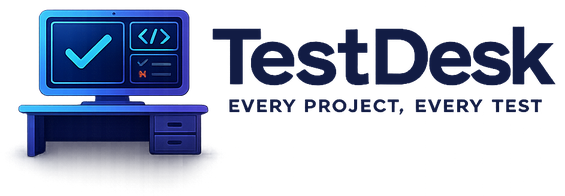

<p align="center">
  <picture>
    <source media="(prefers-color-scheme: dark)" srcset="docs/assets/testdesk-logo-on-dark.png">
    
  </picture>
</p>

<h3 align="center">One desktop app to find, run and debug the tests in all your projects. Your AI agent can drive it too.</h3>

<p align="center">
  <a href="https://github.com/thecodingrasta/testdesk/actions/workflows/ci.yml"></a>
  <a href="https://github.com/thecodingrasta/testdesk/actions/workflows/codeql.yml"></a>
  <a href="https://github.com/thecodingrasta/testdesk/releases"></a>
  <a href="https://github.com/thecodingrasta/testdesk/releases"></a>
  <a href="LICENSE"></a>
  <a href="#install"></a>
  <a href="go.mod"></a>
  <a href="docs/MCP.md"></a>
  <a href="https://github.com/thecodingrasta/testdesk/commits/main"></a>
  <a href="CONTRIBUTING.md"></a>
</p>

TestDesk finds the tests in your projects, runs the ones you pick and shows you what failed and why. It works with the test tools you already use (Go, .NET, Playwright, Vitest, Jest, pytest, Cargo, Maven, Gradle and Cypress) and keeps a separate queue and history for every project, so several can run at once.

It doesn't install test tools or runtimes for you. If `dotnet test` or `npm test` works in your project, TestDesk can run it.

## Install

Grab the download for your system from the [latest release](https://github.com/thecodingrasta/testdesk/releases/latest). No building, no Go, no tooling.

| Your system | App (a single file) | Command-line tool (optional) |
| --- | --- | --- |
| Windows (64-bit) | `TestDesk-<version>-windows-amd64.exe` | `testdesk-cli-<version>-windows-amd64.exe` |
| Linux (64-bit) | `TestDesk-<version>-linux-amd64` | `testdesk-cli-<version>-linux-amd64` |
| Mac with Apple silicon (M1 or newer) | `TestDesk-<version>-macos-arm64.tar.gz` | `testdesk-cli-<version>-macos-arm64` |
| Mac with an Intel chip | `TestDesk-<version>-macos-amd64.tar.gz` | `testdesk-cli-<version>-macos-amd64` |

The app is also the MCP server (`testdesk mcp`), so the app alone is enough for AI tools. A Mac app is a folder, so on a Mac it comes inside the `.tar.gz`. Every system also has a full package (`TestDesk-<version>-<system>-<chip>.zip` or `.tar.gz`) with the same files plus the licence texts.

Not sure which Mac you have? Apple menu, then **About This Mac**, then look at **Chip** or **Processor**.

**Windows**

Download the `.exe`, then in PowerShell put it in a folder on your PATH and open a new terminal:

```powershell
New-Item -ItemType Directory -Force "$HOME\bin" | Out-Null
Move-Item .\TestDesk-[0-9]*-windows-amd64.exe "$HOME\bin\testdesk.exe"
[Environment]::SetEnvironmentVariable('Path', "$([Environment]::GetEnvironmentVariable('Path', 'User'));$HOME\bin", 'User')
```

Run `testdesk`. To use the command-line tool too, save it as `testdesk-cli.exe` in the same folder. Or skip the PATH step and double-click the downloaded file wherever it is.

If SmartScreen warns you, choose **More info**, then **Run anyway**. Builds aren't code-signed yet. TestDesk needs the Microsoft Edge WebView2 runtime, which Windows 11 already has. [Get it here](https://developer.microsoft.com/en-us/microsoft-edge/webview2/) if you're missing it.

**Linux**
```bash
sudo apt-get install libgtk-3-0t64 libwebkit2gtk-4.1-0 libayatana-appindicator3-1   # Ubuntu 24.04 package names
install -D -m 755 TestDesk-*-linux-amd64 ~/.local/bin/testdesk
install -D -m 755 testdesk-cli-*-linux-amd64 ~/.local/bin/testdesk-cli   # optional
testdesk
```
`~/.local/bin` is on the PATH of most distributions; add it if yours isn't. Other distributions name the three libraries differently. The tray icon may need an AppIndicator extension on GNOME.

**macOS**
1. Open the `.tar.gz` to unpack it, then drag the `.app` into **Applications**.
2. Open it. macOS will say it can't check the app for malicious software, because it isn't notarised yet. Go to **System Settings**, then **Privacy & Security**, and choose **Open Anyway**.

For the command-line tool, run `chmod +x testdesk-cli-*-macos-*` and move it to a PATH folder such as `/usr/local/bin/testdesk-cli`. If macOS blocks it, `xattr -d com.apple.quarantine <file>` removes the download flag.

**Check your download (optional).** Each release includes a `SHA256SUMS` file. Compare your file's hash with its line in that file. Windows (PowerShell): `Get-FileHash .\<file>`. macOS: `shasum -a 256 <file>`. Linux: `sha256sum -c SHA256SUMS --ignore-missing`.

Releases are built on real Windows, Linux and macOS runners, and each download is run on a fresh machine before a draft is created. You can read exactly how in the [workflow files](.github/workflows) and [release checks](docs/RELEASING.md).

## Your first run

1. Open TestDesk and choose a project folder.
2. Check the test tools it detected and choose **Set up / add project**.
3. Filter the list, then run one test, a selection or a whole provider.
4. Read the live output. If something fails, **Copy diagnostics** gives you a clean record to share.

More in the [quickstart](docs/QUICKSTART.md).

## Use TestDesk with an AI agent (MCP)

The same app runs as a local MCP server over stdio. There's no network listener and nothing extra to install.

The quickest way: open **Settings**, then **MCP / agentic AI**, and click install next to your tool. TestDesk writes the configuration and keeps a backup of anything it changes.

By hand, Claude Code, Cursor, Antigravity, Windsurf, Cline, Kiro and most other MCP hosts take the same `mcpServers` JSON block, just in different files:

```json
{
  "mcpServers": {
    "testdesk": {
      "command": "C:\\Tools\\TestDesk\\TestDesk.exe",
      "args": ["mcp"]
    }
  }
}
```

Use the real path to your TestDesk executable. On Linux that's the `testdesk` file. On macOS it's the executable inside the app bundle, in `Contents/MacOS`.

| Host | Config file |
| --- | --- |
| Codex | `~/.codex/config.toml` ([TOML format](examples/codex-mcp-config.toml), not JSON) |
| Claude Code | `.mcp.json` in your project |
| Cursor | `.cursor/mcp.json` |
| Antigravity | `~/.gemini/config/mcp_config.json` |
| Windsurf | `~/.codeium/windsurf/mcp_config.json` |
| Cline / Roo Code | `.vscode/mcp.json` |
| OpenCode | `opencode.json` (different format: use the install button or the manual snippet in Settings) |
| Kiro | `.kiro/settings/mcp.json` |
| Other hosts | wherever that host reads `mcpServers` JSON |

Restart the host after saving, then tell your agent:

> **"Use TestDesk MCP to find the tests in this repository, run the ones my change affects and show me any failures."**

The agent can discover tests, plan and run them, read bounded diagnostics and re-run only what failed. Details, every tool and multi-project use: [agent guide](docs/AGENT_GUIDE.md) and [MCP reference](docs/MCP.md).

## Mac users, we need you

Nobody on the project owns a Mac. Automated checks run on macOS (Intel and Apple silicon) for every change, but they can't tell us how the app feels to use.

If you've got a Mac, installing a release and running it against a real project is one of the most useful things you can do. Tell us what worked and what didn't with the [compatibility report](https://github.com/thecodingrasta/testdesk/issues/new?template=compatibility_report.yml). Include your macOS version and chip. Bugs, screenshots and "it just worked" are all welcome.

## Build from source

Only needed if you want to change TestDesk or run an unreleased version. You'll need Go (version in [go.mod](go.mod)), Node.js 22+ for the checks, and the [Wails CLI](https://wails.io) at the version in `go.mod`.

```powershell
# Windows
powershell -NoProfile -ExecutionPolicy Bypass -File .\scripts\windows\Build-TestDesk.ps1
.\dist\TestDesk.exe
```
```bash
# Linux and macOS
bash scripts/build.sh
```

Linux needs GTK and WebKit development packages first, and macOS needs the Xcode Command Line Tools. Full steps, prerequisites and updating are in the [installation guide](docs/INSTALL.md). To produce the same archive a release ships, run `python scripts/package.py`.

## Safety and limits

- Test commands run with your user permissions, the same as running them in a terminal. Only open projects you trust.
- Logs and test artifacts can contain secrets. Check them before you share them.
- Some tools only support running a whole file or provider, not a single case. The [provider matrix](docs/PROVIDERS.md) says which.
- Builds aren't code-signed or notarised yet.

Found a security problem? Please follow [SECURITY.md](SECURITY.md) and don't post it publicly.

## Documentation

| I want to | Read |
| --- | --- |
| Install or update | [Installation](docs/INSTALL.md) |
| Run my first test | [Quickstart](docs/QUICKSTART.md) |
| Configure a project or test tool | [Configuration](docs/CONFIGURATION.md), [Providers](docs/PROVIDERS.md) |
| Connect an AI agent | [Agent guide](docs/AGENT_GUIDE.md), [MCP reference](docs/MCP.md) |
| Work across several repositories | [Multiple projects](docs/MULTI_PROJECT.md) |
| Fix a problem | [Troubleshooting](docs/TROUBLESHOOTING.md), [Support](SUPPORT.md) |
| Understand the code | [Architecture](docs/ARCHITECTURE.md) |
| See how releases are made | [Release checks](docs/RELEASING.md), [Repository automation](docs/AUTOMATION.md) |

## Contribute

Bug reports, fixes, new test-tool support, docs and platform testing are all welcome. Start with [CONTRIBUTING.md](CONTRIBUTING.md). It covers running the checks locally and what a good pull request looks like. Nothing is too small. If it confused you, it will confuse someone else.

## Licence

[GPL-3.0](LICENSE). It allows commercial use and redistribution under its terms. Dependency licences are in the [third-party notices](THIRD_PARTY_NOTICES.md).
