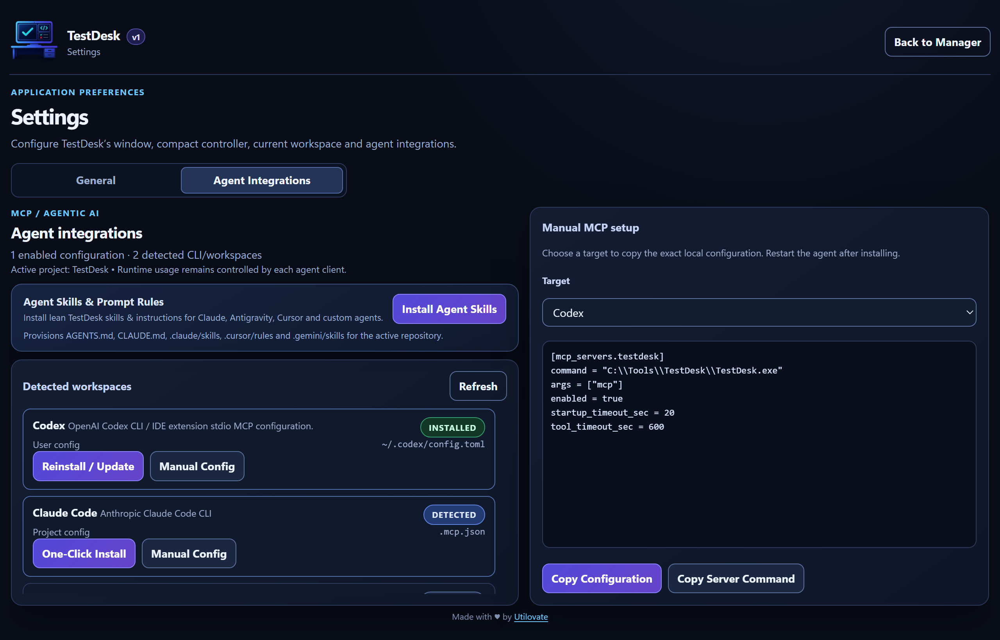

# Agent integration and distribution

TestDesk exposes a local stdio MCP server (`testdesk mcp`), progressive Agent Skills, native host configuration installers, repository marketplaces, and packaged plugin ZIPs (`agent-distribution/testdesk/`).



**Official standards checked 21 November 2026:** [Agent Skills specification](https://agentskills.io/specification), [Agent Plugins 1.0](https://agent-plugins.org/specification), [Model Context Protocol](https://modelcontextprotocol.io/specification), [Claude Code plugins & marketplaces](https://code.claude.com/docs/en/plugins), [OpenAI Codex skills & MCP](https://developers.openai.com/codex/mcp), [OpenAI plugin packaging](https://developers.openai.com/plugins/build/plugins), [Cursor plugins](https://cursor.com/docs/plugins), [GitHub Copilot agent plugins](https://docs.github.com/en/copilot/how-tos/copilot-on-github/customize-copilot/create-and-share-plugin-marketplaces), [VS Code MCP configuration](https://code.visualstudio.com/docs/copilot/chat/mcp-servers), [OpenCode MCP & skills](https://opencode.ai/docs/mcp-servers), and [Antigravity plugins](https://antigravity.google/docs/build-plugins).

## Quick setup in the app

1. Open **Settings** and switch to **Agent Integrations**.
2. Under **Agent Skills & Prompt Rules**, click **Install Agent Skills** to write the lean skill files (`SKILL.md` plus on-demand `references/*.md`) and delimited instruction blocks (`AGENTS.md`, `CLAUDE.md`, `GEMINI.md`, `.cursor/rules/testdesk.mdc`, `.github/copilot-instructions.md`) into the active repository.
3. Under **Detected workspaces**, click **Install** beside a target (or use **Manual MCP setup** to copy the exact JSON or TOML snippet). TestDesk saves a timestamped `.testdesk-backup-*` copy before modifying an existing config file.
4. Restart the host client so it discovers the server and skills.

Wait before executing unfamiliar repositories: provider commands execute with your user permissions. Review `testdesk.json` before registering or running tests in an untrusted repository, and redact sensitive values before sharing diagnostics.

## Host capability matrix

None of the packaged plugin ZIPs bundle the `TestDesk` desktop binary. Each host requires a matching TestDesk release executable on `PATH` (or configured by absolute path in the host config) running in the same OS/architecture environment as the host.

| Host / Standard | Preferred route | Artifact / Config file | Scope & install details | Validation status |
| --- | --- | --- | --- | --- |
| Portable Agent Plugins (Devin, Hermes, Kiro Power) | `testdesk_agent_plugin_v<VER>.zip` or `testdesk_agent_kiro-power_v<VER>.zip` | Root `plugin.json`, `mcp.json`, `skills/` | Requires `testdesk` on `PATH` | Validated by `agentdist`; host UI live run unexercised on Windows |
| Claude Code | Repo marketplace (`.claude-plugin/marketplace.json`), **Install** (`claude-code`), or `testdesk_agent_claude-code_v<VER>.zip` | `.claude-plugin/plugin.json`, `.mcp.json` (`mcpServers`), `.claude/skills/`, `CLAUDE.md` | Project config (`.mcp.json`) plus optional Claude Desktop user config | Validated by `agentdist` + disposable CLI installer test; Claude CLI not installed here |
| OpenAI Codex | **Install** (`codex`) or `examples/codex-mcp-config.toml`; `.agents/skills/` | `~/.codex/config.toml` (`[mcp_servers.testdesk]`), `AGENTS.md`, `.agents/skills/` | User config (`~/.codex/config.toml`); TOML format required | Validated by `agentdist` + disposable installer test; `codex` CLI not installed here |
| OpenAI / ChatGPT skills-only fallback | `testdesk_agent_openai-skills-only_v<VER>.zip` | Root `plugin.json` (`testdesk-skills`), `skills/` | No MCP config bundled; configure Codex MCP separately if allowed | Packaged & validated by `agentdist` |
| Google Antigravity / Gemini | **Install** (`antigravity`) or `testdesk_agent_antigravity_v<VER>.zip` | `.antigravity-plugin/plugin.json` (with square `assets/logo.png`), `~/.gemini/config/mcp_config.json`, `.gemini/skills/testdesk/` | User MCP config + project skills | Validated by `agentdist`; live `agy` CLI not on `PATH` |
| Cursor | Repo marketplace (`.cursor-plugin/marketplace.json`), **Install** (`cursor`), or `testdesk_agent_cursor_v<VER>.zip` | `.cursor-plugin/plugin.json`, `.cursor/mcp.json`, `.cursor/rules/testdesk.mdc`, `skills/` | Project config | Validated by `agentdist`; Cursor IDE not installed here |
| VS Code / GitHub Copilot | Repo marketplace (`.github/plugin/marketplace.json`), **Install** (`vscode` / `cline`), or `testdesk_agent_vscode-copilot_v<VER>.zip` | `.vscode/mcp.json` (`servers.testdesk`, `type: "stdio"`), `.github/copilot-instructions.md`, `.github/skills/` | Project config; repo marketplace supported cleanly by Copilot CLI / VS Code | Validated by `agentdist` + disposable installer test; Copilot CLI not installed here |
| OpenCode | **Install** (`opencode`) or `testdesk_agent_opencode_v<VER>.zip` | `opencode.json` (`mcp.testdesk`, `type: "local"`), `.agents/skills/` | Project config | Validated by `agentdist` + disposable installer test; `opencode` CLI not installed here |
| Windsurf | **Install** (`windsurf`) or Universal manual JSON | `~/.codeium/windsurf/mcp_config.json` (`mcpServers.testdesk`) | User config; shared `AGENTS.md` if read by workspace | Installer tested in Go unit tests |
| Kiro manual setup | `testdesk_agent_kiro_v<VER>.zip` | `.kiro/skills/`, `mcp.json` merged into `.kiro/settings/mcp.json` | Manual merge fallback if not using `testdesk_agent_kiro-power` | Packaged & validated by `agentdist` |

To update an installed manual/host configuration, quit TestDesk and upgrade the desktop binary, then rerun **Install** / `testdesk-cli mcp-install` (or update the plugin ZIP) and restart the host. To remove, restore the `.testdesk-backup-*` file and delete only the `<!-- testdesk:start -->` through `<!-- testdesk:end -->` block.

## Canonical skills and progressive disclosure

Canonical skill definitions live once in `agent-distribution/testdesk/plugin/skills/`. Run `go run ./scripts/sync-agent-assets` to synchronize them across:
- embedded templates in `internal/agents/embedded/skills/` (compiled into `TestDesk` and installed by `testdesk_skills_install`),
- repository copies under `.agents/skills/`, `.claude/skills/`, `.gemini/skills/testdesk/`, `.cursor/rules/`, `AGENTS.md`, `CLAUDE.md`, `GEMINI.md`, and `.github/copilot-instructions.md`,
- marketplace source copies under `agent-distribution/testdesk/adapters/{claude-code,cursor}/skills/`.

Each `SKILL.md` keeps trigger metadata and core workflow steps concise (~1.2 to 1.9 KB), moving deep tool parameter schemas, CLI flags, timeout/disconnect rules, result-evidence caveats, and multi-project routing details into on-demand `references/*.md` files (~12.8 KB total across five reference documents loaded only when needed). Compared to the prior flat inline strings (4,085 B total with zero reference files), activation stays compact while covering all 24 MCP tools, resources, prompts, CLI subcommands, and disconnect/timeout semantics cleanly.

## Standard agent workflow

1. Call `testdesk_capabilities` (or `testdesk_guide`) and `testdesk_snapshot` with `includeTests: false`.
2. Call `testdesk_tests` with narrow filters (`project`, `providerIds`, `layers`, `modules`, `statuses`, `tags`, `query`) and keep exact `testId` values.
3. Call `testdesk_plan` before broad runs to inspect execution granularity and overlap warnings.
4. Queue with `testdesk_run`, await with `testdesk_wait` (`timeoutMs: 30000`), and inspect `testdesk_run_status`.
5. On failure, call `testdesk_diagnostics` with `runId` and `maxBytes: 4096`, inspect `testdesk_test_details` or `testdesk_artifacts`, fix the issue, and run `testdesk_rerun_failed`.
6. Inspect additional capabilities on demand via MCP `tools/list`, `resources/list` (`testdesk://guide`, `testdesk://capabilities`, `testdesk://projects`), and `prompts/list` (`testdesk-verify-changes`, `testdesk-debug-failure`, `testdesk-plan-suite`).

## Validating and packaging distributions

Run the Go distribution validator and packager from the repository root:

```bash
go run ./tools/agentdist validate --release-version "$(cat VERSION)"
go run ./tools/agentdist package --version "$(cat VERSION)" --output dist-agents
```

`validate` checks every `SKILL.md` and `references/*.md` file, verifies all 24 MCP tool references against `internal/mcp/server.go` and `internal/mcp/v1.go`, validates typed argument examples in `agent-distribution/testdesk/contracts.json`, checks CLI commands against `cmd/testdesk/main.go`, verifies all adapter manifests and repository marketplaces, and confirms zero drift across generated copies. See [MCP integration](MCP.md) for wire behavior and [Releases](RELEASING.md) for release packaging.
