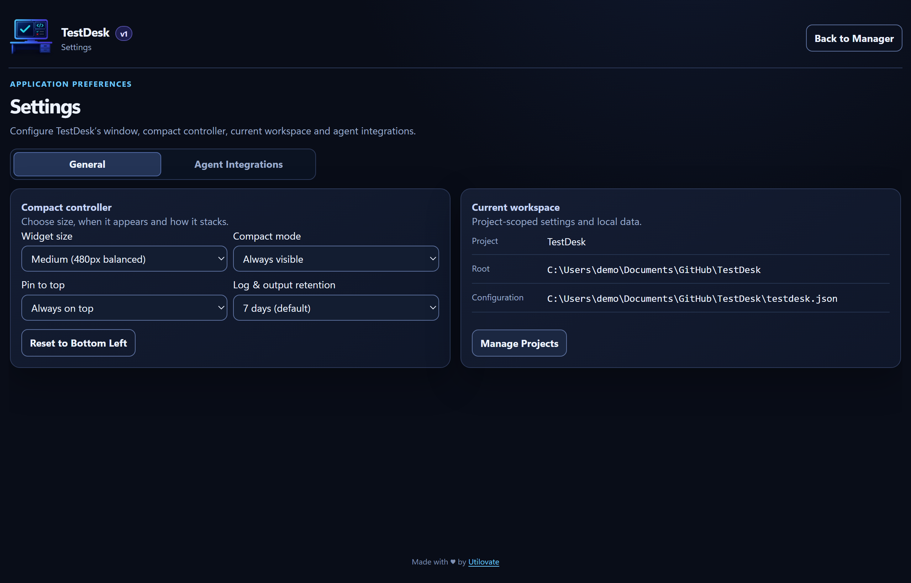

# Configuration

Each project stores its configuration in `testdesk.json` at the repository root. TestDesk creates this file during setup and normalises safe defaults for window dimensions, retention, and provider entries.

When a repository already has a `.gitignore`, setup appends one idempotent entry for the configured `workspace` (default `.testdesk/`). TestDesk never creates a new `.gitignore` if none exists and never adds ignores for absolute external workspace paths.

Compact controller and retention preferences can be changed interactively under **Settings**, **General** tab, which updates both `testdesk.json` and global preferences.

## Core `testdesk.json` fields

- `name`: display name shown in project switchers and MCP project lists.
- `workspace`: per-project state folder relative to project root; defaults to `.testdesk`.
- `ui.widgetSize`: `small` (`380px` HUD), `medium` (`480px` balanced, default), or `large` (`580px` spacious).
- `ui.widgetMode`: `when_active` (**Auto (show on run / minimise)**, default), `always` (**Always visible**), or `off` (**Off / manual only**).
- `ui.topmostMode`: `always` (**Always on top**), `when_active` (**While running tests only**), or `off` (**Off**). Defaults to `always` on legacy configs with `alwaysOnTop: true`, otherwise `off`.
- `ui.alwaysOnTop`: legacy boolean derived from `topmostMode == "always"`.
- `ui.logRetentionDays`: days before pruning old run artifacts (`7` default, `0` to keep indefinitely).
- `providers`: list of test runner adapter objects (`discover`, `run.all`, `run.test`, `results`).

Never place secrets, tokens, or credentials inside `testdesk.json`. Provider commands inherit the process environment so you can supply secrets through normal OS or shell environment variables.

See [Providers](PROVIDERS.md) for adapter schemas and placeholder tokens.

## Locations and environment

Global preferences and desktop lifecycle files live in the OS configuration directory:

- **Windows:** `%APPDATA%\TestDesk`
- **macOS:** `~/Library/Application Support/TestDesk`
- **Linux:** `$XDG_CONFIG_HOME/TestDesk` (typically `~/.config/TestDesk`)

Set `TESTDESK_CONFIG_HOME` to override the base directory (TestDesk appends `TestDesk` underneath it), which isolates tests and disposable runs from user settings.

Set `TESTDESK_DESKTOP_EXECUTABLE` when invoking `testdesk-cli mcp` and the desktop binary is not in the same directory as the CLI.
