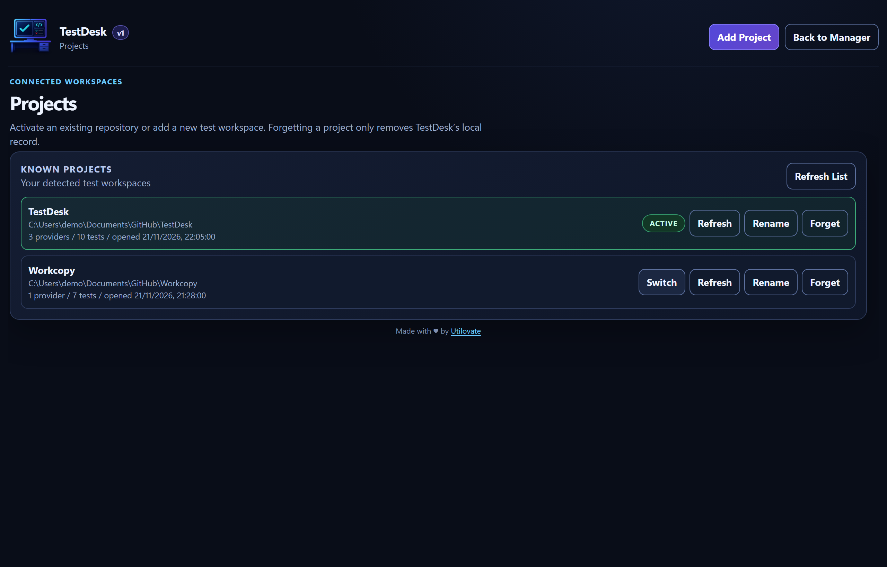
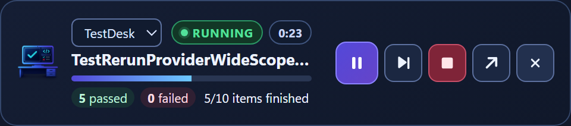

# Multi-project operation

TestDesk keeps a per-user registry of recent projects under the OS user configuration directory. Each project owns an independent `.testdesk` workspace with its own test catalog, run history, logs, and diagnostics.

Use the active-project dropdown in the manager header (or compact widget project selector when multiple projects are active) to switch views quickly. On the **Projects** screen you can:

- view provider/test counts and last-opened timestamps;
- **Switch** to another configured workspace (the currently selected workspace shows an **Active** badge);
- **Add Project**, browse to a folder, **Preview Detection**, and register it;
- **Refresh** provider configuration or **Rename** the display name;
- **Forget** a project entry without deleting files in the repository.

Over MCP, use `testdesk_projects`, `testdesk_project_add`, and `testdesk_project_activate`. Calling `testdesk_project_activate` updates only that MCP connection's session default without cancelling or modifying other projects. Every project-scoped MCP tool also accepts an optional `project` parameter (name or absolute root) so agents can run and inspect tests across multiple repositories concurrently.
