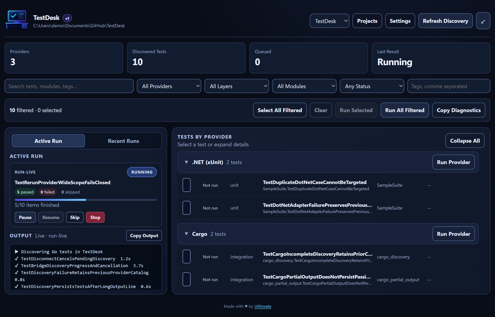
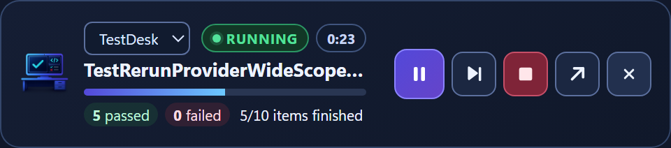

# Quickstart

1. Open **TestDesk**. On a fresh setup, the **Projects** screen opens first so you can add a repository.
2. Click **Add Project** (or enter a folder path directly if the sheet is already open) and browse to a trusted project folder.
3. Click **Preview Detection** to review the detected test tools, leave **Discover tests immediately** checked, and click **Add Project**.
4. In the manager, filter tests by search text, provider, layer, module, status, or tags. Check individual tests or click **Run Provider** / **Run Selected** / **Run All Filtered**.
5. Monitor live output in the **Output** panel (`Live · <runId>`). Switch to **Recent Runs** to inspect earlier output, click **Rerun Failed** on a failing run, or click **Copy Diagnostics** for a shareable summary.

Use **Projects** in the top bar to switch, refresh, rename, or forget workspaces without restarting TestDesk. Open **Settings**, then switch between the **General** tab (widget size, auto-show behavior, pinning, retention) and **Agent Integrations** tab (installing repo skills or MCP host configs).

By default, **Compact mode** is set to **Auto (show on run / minimise)** (`when_active`), positioning a frameless controller in the bottom-left work area, clear of the taskbar. Drag it anywhere to save a new screen location, or click **Reset to Bottom Left** in Settings. Use the rightmost inline **Hide to Tray** (`×`) button in the controller to tuck it back into the tray; click **Open Manager** (`↗`) to return to the full window.

