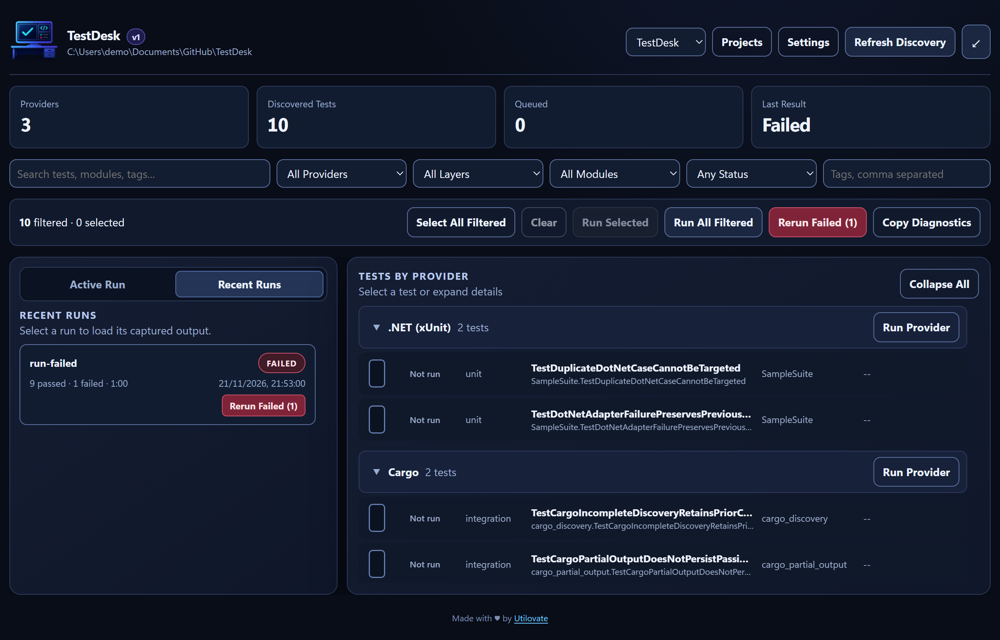

# Troubleshooting

## Build fails

Confirm `go version` meets `go.mod`, `wails version` matches the Wails v2 version in `go.mod` (`go list -m github.com/wailsapp/wails/v2`), and `wails doctor` reports no missing native dependencies. The frontend has no npm install step.

On Linux, install WebKitGTK 4.1 development libraries and pass `-tags webkit2_41` for native builds and tests. Always prefer the repository scripts (`Build-TestDesk.ps1`, `scripts/build.sh`, `scripts/package.py`), which pass `-skipbindings` and prevent Wails from altering `go.mod` on newer Go toolchains. If Windows locks `dist\TestDesk.exe` while rebuilding, close the running app or pass `-OutputDirectory <other-path>`.

## Windows app will not open

Install the [Microsoft Edge WebView2 Evergreen Runtime](https://developer.microsoft.com/en-us/microsoft-edge/webview2/) on Windows 10 if missing, confirm you downloaded the `windows-amd64` build matching your CPU, and verify the checksum against `SHA256SUMS`.

## macOS says the app cannot be opened

Builds are not signed or notarised yet. Open **System Settings**, go to **Privacy & Security**, and click **Open Anyway** next to TestDesk after checking `SHA256SUMS`. Confirm you downloaded `arm64` for Apple silicon or `amd64` for Intel.

## Tray icon missing or MCP startup unavailable

If the desktop's system tray icon fails to register on restricted desktop environments or headless Linux sessions, TestDesk still exposes the MCP loopback service after DOM startup (falling back after a 5-second tray initialization guard). On Linux GNOME desktops, install an AppIndicator extension to see the tray icon cleanly.

When using `testdesk-cli mcp`, keep `testdesk-cli` alongside the desktop executable or set `TESTDESK_DESKTOP_EXECUTABLE` to the desktop executable's absolute path (inside `Contents/MacOS/testdesk` on macOS). Always restart your MCP client host after editing its config. Choosing **Exit TestDesk** ends the desktop owner and disconnects active bridges.

## No tests, ambiguous selection, or `unknown` results

Check provider commands in `testdesk.json` and run **Refresh Discovery** after upgrading TestDesk. Make sure the project's underlying test runner and any required reporter package (such as `jest-junit`) are installed.

Always prefer catalog IDs over bare names when running single cases. Missing, malformed, or ambiguous result reports never produce a passing outcome; TestDesk keeps unmatched items as `unknown`. See [provider limits](PROVIDERS.md).

On Windows, npm-based runners execute through `cmd.exe`, which silently truncates or drops `PATH` entries if the total environment `PATH` exceeds 8,191 characters. If installed JS tools fail with `"is not recognized"`, launch TestDesk from a fresh shell with a shorter `PATH`.

## Run is stuck or output hits the 32 MiB cap

**Pause** stops new queued items from starting without suspending an already-running process. **Stop** (and `kill` over MCP) cancels active work and clears queued runs; child processes that detach from their Windows Job Object or POSIX process group may require manual cleanup.

Each stdout/stderr capture is capped at 32 MiB, including single long lines. Exceeding 32 MiB cancels the run with an explicit capture-limit error. Narrow your test filter or quiet noisy runner logging. Manage saved disk space via **Log & output retention** in **Settings**.

## Undo an agent integration or remove skills

Restore the timestamped `.testdesk-backup-*` config or skill file created next to the target before installation, then restart the client host. For shared instruction files (`AGENTS.md`, `CLAUDE.md`, `GEMINI.md`, `.github/copilot-instructions.md`), delete only the delimited `<!-- testdesk:start -->` through `<!-- testdesk:end -->` block.

## Compact widget window or position looks wrong

Open **Settings**, **General** tab, and click **Reset to Bottom Left** to restore the widget cleanly onto the primary monitor's bottom-left work area. Look under **Compact mode** if the widget is hidden when idle (`Auto` shows it only while tests are running or the manager is minimised).

## Find logs and diagnostics from a failed run

Open the **Recent Runs** tab in the manager, click a failing run to view its saved output (`Saved · <runId>`), and click **Copy Diagnostics** or **Rerun Failed**. Click **View Active Run** to return to live output.

## Report a problem cleanly

Include your TestDesk version (`testdesk --version`), OS and CPU architecture, test runner version, affected project/provider, minimal reproduction steps, and bounded diagnostics with credentials and private paths removed. See [Support](../SUPPORT.md).
